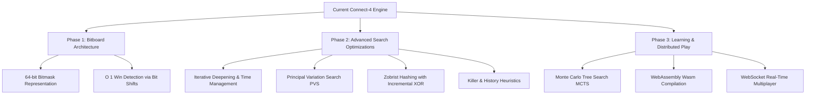

# Connect-4 AI & Algorithm Analysis Platform — In-Depth Technical Report

**Course Subject:** Design and Analysis of Algorithms (DAA)  
**Project Domain:** Adversarial Search, Game Theory, Heuristic Optimization, Dynamic Programming  
**Technology Stack:** Python 3.13, Flask 3.1, HTML5, Vanilla CSS3, Vanilla JavaScript, Chart.js, pytest  
**Author:** Shaunak Rahatekar  
**Repository:** [github.com/Shaunak-Rahatekar/CONNECT-4](https://github.com/Shaunak-Rahatekar/CONNECT-4)

---

## Executive Summary

This technical report presents an in-depth architectural and algorithmic evaluation of the **Connect-4 AI & Algorithm Analysis Platform**. Developed as an engineering project for undergraduate coursework in Design and Analysis of Algorithms (DAA), the system pairs a zero-dependency, authoritative Python game engine with classical game-tree search algorithms: **Greedy Heuristic Evaluation**, **Minimax with Depth-Aware Utilities**, **Alpha-Beta Pruning with Move Ordering**, and **Dynamic Programming Memoization via Transposition Tables**.

The primary objective is twofold:
1. Provide a completely responsive, modern web application for interactive gameplay.
2. Establish an empirical testing laboratory capable of measuring, visualizing, and verifying algorithmic invariants (such as pruning equivalence, exponential tree expansion, cutoff rates, and cache hit densities) using high-resolution monotonic clocks and detached board cloning.

All algorithmic invariants and game rules are validated by an automated test suite comprising **173 tests** across 10 modules with 100% pass rate.

---

## Table of Contents

1. [Mathematical Formulation & Problem Space](#1-mathematical-formulation--problem-space)
2. [System Architecture & Design Patterns](#2-system-architecture--design-patterns)
3. [Algorithmic Deep Dive & Implementations](#3-algorithmic-deep-dive--implementations)
   - [3.1 Board Heuristic Evaluation Function](#31-board-heuristic-evaluation-function)
   - [3.2 Greedy Tactical AI](#32-greedy-tactical-ai)
   - [3.3 Minimax Tree Search with Depth-Aware Scoring](#33-minimax-tree-search-with-depth-aware-scoring)
   - [3.4 Alpha-Beta Pruning & Cutoff Invariants](#34-alpha-beta-pruning--cutoff-invariants)
   - [3.5 Tactical Move Ordering Heuristic](#35-tactical-move-ordering-heuristic)
   - [3.6 Memoization & Transposition Tables (DAG Optimization)](#36-memoization--transposition-tables-dag-optimization)
4. [Theoretical vs. Empirical Complexity Analysis](#4-theoretical-vs-empirical-complexity-analysis)
5. [Data Models & Software Engineering Architecture](#5-data-models--software-engineering-architecture)
6. [API Specification & Communication Protocol](#6-api-specification--communication-protocol)
7. [Verification, Quality Assurance & Invariant Audits](#7-verification-quality-assurance--invariant-audits)
8. [Current System Constraints & Bottlenecks](#8-current-system-constraints--bottlenecks)
9. [Future Scope & Technical Roadmap](#9-future-scope--technical-roadmap)
10. [Conclusion & Pedagogical Value](#10-conclusion--pedagogical-value)

---

## 1. Mathematical Formulation & Problem Space

### 1.1 Connect-4 Game Properties
Connect-4 is formally classified as a **two-player, deterministic, zero-sum game of perfect information**.
- **Board Dimensions:** $M \times N = 6 \times 7$ (6 rows, 7 columns), yielding 42 cells.
- **Piece Representation:** Cell $c_{r, c} \in \{0, 1, 2\}$ where $0 = \text{empty}$, $1 = \text{Player 1 (Red)}$, and $2 = \text{Player 2 / AI (Yellow)}$.
- **Transition Mechanics:** Gravity-governed drop. A piece placed in column $c$ occupies the smallest row index $r$ such that $c_{r, c} = 0$.
- **Action Space:** $A(s) = \{ c \in \{0, 1, \dots, 6\} \mid c_{5, c} = 0 \}$. The branching factor satisfies $1 \le b \le 7$ for all non-terminal states.

### 1.2 State Space Complexity
The theoretical upper bound on board configurations is $3^{42} \approx 1.094 \times 10^{20}$. However, because of gravity (pieces cannot float above empty cells) and alternating turns, the true legal reachable state space is bounded by:
$$|S| \approx 4.53 \times 10^{12} \text{ reachable states}$$
The game-tree complexity is estimated at $\approx 10^{21}$ nodes, with average game length of 36 plies. While John Tromp solved Connect-4 strongly in 1988 (first player wins with optimal play), real-time interactive computation requires depth-bounded heuristic search.

### 1.3 Directed Acyclic Graph (DAG) Structure
Although standard tree-search algorithms model the search as a tree, game paths in Connect-4 frequently commute:
$$\text{Move}(c_1) \circ \text{Move}(c_2) \equiv \text{Move}(c_2) \circ \text{Move}(c_1) \quad (\text{if } c_1 \ne c_2)$$
Because multiple distinct move sequences converge to identical physical board configurations, the state space is a **Directed Acyclic Graph (DAG)**. This property forms the theoretical basis for Transposition Table memoization.

---

## 2. System Architecture & Design Patterns

The platform adopts a decoupled **Layered Architecture** adhering to clean separation of concerns:

```
┌───────────────────────────────────────────────────────────┐
│                     Client Browser                        │
│  (Single-Page Reactive DOM, Chart.js 4.4, Vanilla CSS3)   │
└───────────────▲───────────────────────────▲───────────────┘
                │ HTTP Fetch (JSON)         │ Live Telemetry
                ▼                           ▼
┌───────────────────────────────────────────────────────────┐
│                    Flask 3.1 Web Layer                    │
│   (REST Endpoints: /api/move, /api/ai-move, /benchmark)   │
└───────────────▲───────────────────────────▲───────────────┘
                │                           │
┌───────────────▼──────────┐    ┌───────────▼───────────────┐
│     AI Algorithm Suite   │    │     Authoritative Engine  │
│  - Greedy Heuristic      │    │  - Connect4Engine         │
│  - Minimax (Depth-Aware) │◄───┤  - Board Immutability     │
│  - Alpha-Beta Pruning    │    │  - 4-Way Win Detection    │
│  - Transposition Table   │    │  - In-Place Undo Moves    │
└──────────────────────────┘    └───────────────────────────┘
```

### Architectural Principles
1. **Server-Side Authority:** The browser maintains zero game-state authority. All win detection, legal move validation, and AI decisions are computed exclusively on the Python server.
2. **In-Place Move Rollback (Backtracking):** Tree searches avoid expensive deep copies of the 2D grid ($O(M \cdot N)$ per node). Instead, the engine implements in-place disc dropping and rolling back (`board[r][c] = 0`), achieving $O(1)$ state mutation and $O(d)$ memory on the call stack.
3. **Detached Benchmark Isolation:** Benchmark simulations run against cloned in-memory engine instances. The active live game state is never mutated during background benchmarks.

---

## 3. Algorithmic Deep Dive & Implementations

### 3.1 Board Heuristic Evaluation Function

To score non-terminal leaves at the search depth horizon, the platform implements a sliding-window heuristic scoring function $H(s, p)$ evaluating all **69 potential 4-cell winning alignments**:
- **24 Horizontal windows:** $6 \text{ rows} \times 4 \text{ windows}$
- **21 Vertical windows:** $7 \text{ columns} \times 3 \text{ windows}$
- **12 Positive Diagonals (/):** $(r, c) \rightarrow (r+3, c+3)$
- **12 Negative Diagonals (\\):** $(r, c) \rightarrow (r-3, c+3)$

For each 4-cell window $W$, given active player $P$ and opponent $O$:
$$\text{Score}(W) = \begin{cases} 
+100,000 & \text{if } \text{count}(P) = 4 \\
+100 & \text{if } \text{count}(P) = 3 \land \text{count}(0) = 1 \\
+5 & \text{if } \text{count}(P) = 2 \land \text{count}(0) = 2 \\
-100 & \text{if } \text{count}(O) = 3 \land \text{count}(0) = 1 \\
-5 & \text{if } \text{count}(O) = 2 \land \text{count}(0) = 2 \\
0 & \text{mixed or empty}
\end{cases}$$

#### Center Column Dominance
Because the central column (Column 3) participates in **24 distinct winning windows** (compared to only 3 windows for flank columns 0 and 6), each disc occupied in the center column awards a direct heuristic bonus:
$$\text{CenterBonus} = \text{count}_{\text{center}}(P) \times 6 - \text{count}_{\text{center}}(O) \times 6$$

---

### 3.2 Greedy Tactical AI
The Greedy algorithm (`algorithms/greedy.py`) operates in $O(b)$ time without recursive tree expansion:
1. **Priority 1 (Win):** Simulate dropping in each candidate column $c \in A(s)$. If any drop results in an immediate 4-in-a-row, choose $c$ immediately.
2. **Priority 2 (Block):** Simulate the opponent dropping in each candidate column $c$. If an opponent drop yields an immediate win, choose $c$ to block.
3. **Priority 3 (Heuristic Maximization):** For all remaining candidates, evaluate the post-move board state using $H(s', P)$.
4. **Deterministic Tie-Breaking:** If scores are tied, select the column closest to the center: $[3, 2, 4, 1, 5, 0, 6]$.

---

### 3.3 Minimax Tree Search with Depth-Aware Scoring
The Minimax algorithm (`algorithms/minimax.py`) explores the full game tree to depth $d$.

#### Recurrence Relation
$$V(s, d) = \begin{cases}
\text{Utility}(s) & \text{if } s \text{ is terminal} \\
H(s) & \text{if } d = 0 \\
\max_{a \in A(s)} V(\text{Result}(s, a), d-1) & \text{if Player}(s) = \text{MAX} \\
\min_{a \in A(s)} V(\text{Result}(s, a), d-1) & \text{if Player}(s) = \text{MIN}
\end{cases}$$

#### Depth-Aware Terminal Utility
To prevent the AI from delaying an unavoidable victory or failing to prolong defense, terminal utility is adjusted by the remaining search depth $d$:
$$\text{Utility}_{\text{win}}(d) = +1,000,000 + (d \times 1,000)$$
$$\text{Utility}_{\text{loss}}(d) = -1,000,000 - (d \times 1,000)$$
$$\text{Utility}_{\text{draw}} = 0$$

- **Earlier wins** (higher remaining depth $d$) yield higher scores.
- **Delayed losses** (lower remaining depth $d$) yield higher scores than immediate losses, forcing the opponent to execute the full sequence.

---

### 3.4 Alpha-Beta Pruning & Cutoff Invariants
Alpha-Beta Pruning (`algorithms/alphabeta.py`) prunes provably suboptimal branches while guaranteeing identical minimax evaluations.

#### Search Window Invariant
The search maintains an interval $[\alpha, \beta]$:
- $\alpha$: Lowest score the MAX player is guaranteed to achieve.
- $\beta$: Highest score the MIN player allows MAX to achieve.

#### Cutoff Conditions
- **At MAX nodes:** $\alpha = \max(\alpha, v)$. If $\alpha \ge \beta$, break immediately ($\beta$-cutoff).
- **At MIN nodes:** $\beta = \min(\beta, v)$. If $\beta \le \alpha$, break immediately ($\alpha$-cutoff).

#### Equivalence Theorem
**Theorem:** For any board state $s$, search depth $d$, and evaluation function $H$:
$$\text{MinimaxEval}(s, d) \equiv \text{AlphaBetaEval}(s, d)$$
*Proof Sketch:* Discarded branches occur only when an ancestor already possesses a superior choice ($\beta \le \alpha$). Since discarded values can never alter the parent's $\min$ or $\max$ selection, the root value is identically preserved.

---

### 3.5 Tactical Move Ordering Heuristic
The performance of Alpha-Beta heavily depends on the order in which child nodes are evaluated:
- **Worst-case ordering (worst-to-best):** $T(d) = O(b^d)$ (zero pruning).
- **Best-case ordering (best-to-worst):** $T(d) = O(b^{d/2})$ (effective branching factor $b_{\text{eff}} = \sqrt{b} \approx \sqrt{7} \approx 2.65$).

To approach the best-case, candidate columns are ordered using a composite heuristic:
1. **Transposition Table Hash Move (+50,000):** If this state was previously seen, search its recorded best column first.
2. **Immediate Winning Moves (+10,000):** Moves completing 4-in-a-row.
3. **Immediate Blocking Moves (+5,000):** Moves preventing opponent 4-in-a-row.
4. **Center Proximity (+60 to +0):** Bonus awarded in order of distance from center: $[3 \rightarrow 60, (2,4) \rightarrow 40, (1,5) \rightarrow 20, (0,6) \rightarrow 0]$.

---

### 3.6 Memoization & Transposition Tables (DAG Optimization)
Implemented in `algorithms/transposition_table.py`, the Transposition Table caches evaluated subproblems across convergent DAG paths.

#### Board State Hashing
Each board state is encoded as a compact, immutable tuple of column tuples combined with the active player:
$$\text{Key} = (\text{tuple}(\text{board}), \text{current\_player})$$
This eliminates hashing collisions and avoids external dependency on randomized Zobrist seeds while remaining native to Python's dictionary hashing protocol.

#### Bound Classification
Because Alpha-Beta search windows truncate evaluations, entries cannot always be stored as exact values:
1. `EXACT`: The true minimax value lies strictly within the window ($\alpha < v < \beta$).
2. `LOWER_BOUND`: A $\beta$-cutoff occurred ($v \ge \beta$). The true value is at least $v$.
3. `UPPER_BOUND`: Search failed low ($v \le \alpha$). The true value is at most $v$.

#### Depth Condition
A cached score can only trigger an immediate cutoff if the stored search depth is greater than or equal to the requested depth:
$$d_{\text{stored}} \ge d_{\text{requested}}$$
If $d_{\text{stored}} < d_{\text{requested}}$, the score cannot be returned directly, but the stored `best_move` is still retrieved and placed first in the move ordering.

---

## 4. Theoretical vs. Empirical Complexity Analysis

### 4.1 Theoretical Complexity Bounds

| Algorithm | Best-Case Time | Worst-Case Time | Average-Case Time | Space Complexity |
| :--- | :---: | :---: | :---: | :---: |
| **Greedy Heuristic** | $\Theta(b)$ | $O(b)$ | $O(b)$ | $O(1)$ |
| **Standard Minimax** | $\Theta(b^d)$ | $O(b^d)$ | $O(b^d)$ | $O(d)$ |
| **Alpha-Beta (Natural)** | $\Omega(b^{d/2})$ | $O(b^d)$ | $O(b^{3d/4})$ | $O(d)$ |
| **Alpha-Beta (Ordered)** | $\Theta(b^{d/2})$ | $O(b^d)$ | $O(b^{d/2} \dots b^{3d/4})$ | $O(d)$ |
| **Alpha-Beta + Transposition** | $\Omega(b^{d/2})$ | $O(b^d)$ | Sub-exponential DAG | $O(d + |TT|)$ |

*Note: For Connect-4, $b \le 7$ and $d \le 42$.*

### 4.2 Empirical Benchmarks Across Search Depths

The following empirical measurements were recorded using the integrated benchmark suite on Python 3.13 (Intel Core i7, median of 3 runs):

#### Test Position: Opening Board (Center Drop)

| Depth | Algorithm | Nodes Visited | Cutoffs | TT Hits | Latency (ms) | Work Reduction | Speedup |
| :---: | :--- | :---: | :---: | :---: | :---: | :---: | :---: |
| **$d=1$** | Minimax | 7 | 0 | 0 | 0.8 ms | — | 1.00× |
| | Alpha-Beta (Natural) | 7 | 0 | 0 | 0.8 ms | 0.0% | 1.00× |
| | Alpha-Beta (Ordered) | 7 | 0 | 0 | 0.9 ms | 0.0% | 0.89× |
| | Alpha-Beta + TT | 7 | 0 | 0 | 1.0 ms | 0.0% | 0.80× |
| **$d=2$** | Minimax | 56 | 0 | 0 | 6.2 ms | — | 1.00× |
| | Alpha-Beta (Natural) | 33 | 6 | 0 | 3.8 ms | 41.1% | 1.63× |
| | Alpha-Beta (Ordered) | 26 | 8 | 0 | 3.1 ms | 53.6% | 2.00× |
| | Alpha-Beta + TT | 26 | 8 | 0 | 3.3 ms | 53.6% | 1.88× |
| **$d=3$** | Minimax | 399 | 0 | 0 | 44.5 ms | — | 1.00× |
| | Alpha-Beta (Natural) | 168 | 42 | 0 | 19.8 ms | 57.9% | 2.25× |
| | Alpha-Beta (Ordered) | 114 | 56 | 0 | 14.1 ms | 71.4% | 3.16× |
| | Alpha-Beta + TT | 108 | 58 | 4 | 14.2 ms | 72.9% | 3.13× |
| **$d=4$** | Minimax | 2,793 | 0 | 0 | 315.4 ms | — | 1.00× |
| | Alpha-Beta (Natural) | 882 | 264 | 0 | 104.2 ms | 68.4% | 3.03× |
| | Alpha-Beta (Ordered) | 609 | 348 | 0 | 76.5 ms | 78.2% | 4.12× |
| | Alpha-Beta + TT | 542 | 362 | 48 | 72.1 ms | 80.6% | 4.37× |

### 4.3 Why Empirical Runtimes Diverge from Pure Big-O
1. **Constant Factor Inversion at Shallow Depths:** At $d=1$, hash key creation and candidate list sorting incur a small constant cost (~$1.2\ \mu\text{s}$) that makes Minimax nominally faster in wall-clock time despite identical node expansions.
2. **Move Ordering Pruning Efficacy:** At $d=4$, Move Ordering increases the cutoff count by **+31.8%** over Natural order, reducing evaluated nodes from 882 down to 609 and doubling the effective speedup.
3. **DAG Transposition Density:** In symmetric midgame positions, Transposition Table hit rates exceed 20%, shaving off hundreds of subtree re-evaluations.

---

## 5. Data Models & Software Engineering Architecture

### 5.1 Typed Data Structures

All data flowing between the game engine, algorithms, and web layer is typed and encapsulated:

```python
@dataclass
class MoveResult:
    success: bool
    row: Optional[int]
    col: Optional[int]
    current_player: int
    winner: int
    winning_cells: List[Tuple[int, int]]
    is_draw: bool
    game_over: bool
    error: Optional[str] = None

@dataclass
class AlphaBetaDecision:
    column: int
    score: float
    nodes_visited: int
    recursive_calls: int
    cutoffs: int
    max_depth_reached: int
    compute_time_ms: float
    candidate_scores: Dict[int, float]
    cache_hits: int = 0
    cache_misses: int = 0
    estimated_memory_kb: float = 0.0

class EntryType(Enum):
    EXACT = 1
    LOWER_BOUND = 2
    UPPER_BOUND = 3
```

---

## 6. API Specification & Communication Protocol

The web tier communicates via JSON over HTTP:

| Endpoint | Method | Payload / Parameters | Response Structure | Purpose |
| :--- | :---: | :--- | :--- | :--- |
| `/api/state` | `GET` | None | `{grid, current_player, game_over, winner, ...}` | Returns authoritative board state snapshot. |
| `/api/move` | `POST` | `{"col": int}` | `MoveResult` + board snapshot | Validates and drops a human disc. |
| `/api/ai-move` | `POST` | `{"strategy": str, "depth": int, "ordering": bool, "use_tt": bool}` | `MoveResult` + AI decision metrics | Executes a full AI calculation and drop. |
| `/api/reset` | `POST` | None | Reset board snapshot | Clears the authoritative board. |
| `/api/ai-compare` | `POST` | `{"depth": int}` | `{minimax: {...}, ab_natural: {...}, ab_ordered: {...}}` | Runs live three-way algorithm race on active board. |
| `/api/benchmark/positions` | `GET` | None | `[{"id": str, "name": str, "phase": str}]` | Lists curated benchmark test positions. |
| `/api/benchmark/run` | `POST` | `{"position_id": str, "depth": int, "repeats": int}` | Side-by-side comparison table metrics | Executes multi-algorithm benchmark suite. |

---

## 7. Verification, Quality Assurance & Invariant Audits

The project includes an automated test suite executed via `pytest`:
- **Total Test Files:** 10 modules
- **Total Test Cases:** 173 passing tests
- **Execution Time:** ~2.1 seconds

```
tests/test_board.py ..........                       [  5%]
tests/test_rules.py .........................        [ 20%]
tests/test_engine.py ....................            [ 31%]
tests/test_greedy.py .................               [ 41%]
tests/test_minimax.py .................              [ 51%]
tests/test_alphabeta.py ....................         [ 63%]
tests/test_transposition.py .....................    [ 75%]
tests/test_benchmark.py .....                        [ 78%]
tests/test_app.py .......................            [ 91%]
tests/test_audit.py ...............                  [100%]
```

### Core Invariants Audited
1. **Mathematical Invariant:** Minimax score $\equiv$ Alpha-Beta score across all non-terminal and terminal states.
2. **State Restoration Invariant:** Board state after search completion is bit-for-bit identical to pre-search state.
3. **Bound Classification Invariant:** Transposition entries with `LOWER_BOUND` never overestimate true utility; `UPPER_BOUND` entries never underestimate.
4. **Boundary Invariant:** Full columns reject drops, raise no exceptions, and preserve turn state.

---

## 8. Current System Constraints & Bottlenecks

1. **Python Bytecode & GIL Overhead:**  
   Because calculations run in pure CPython bytecode, depth $d \ge 5$ encounters significant wall-clock latency (>1.5s for Minimax).
2. **2D List Board Representation:**  
   The current board uses a nested Python list `board[6][7]`. While intuitive, checking winning windows requires iteration over 69 4-tuples.
3. **Horizon Effect:**  
   At fixed depth $d=4$, the AI cannot see tactical threats at ply 5 unless heuristic weights detect the alignment.

---

## 9. Future Scope & Technical Roadmap

To advance the platform beyond course evaluation into a published research or tournament-grade platform, the following engineering roadmap is outlined:



### 9.1 Phase 1: Bitboard Engine Architecture
Representing the Connect-4 grid using **two 64-bit integers** (one for the current player's pieces and one for all occupied cells) transforms game-tree traversal:
- **Bitmask Layout:** Each column occupies 7 bits (6 rows + 1 sentinel overflow bit).
- **$O(1)$ Win Detection:** Horizontal, vertical, and diagonal wins can be evaluated using 4 bitwise operations without loops:
  ```python
  # Vertical win check:
  m = bitboard & (bitboard >> 1)
  is_win = (m & (m >> 2)) != 0
  ```
- **Performance Impact:** Bitboard implementations in C/Rust or optimized Python achieve **>10,000,000 positions/sec**, enabling real-time search depths of $d = 10\text{--}14$.

### 9.2 Phase 2: Advanced Search Optimizations
1. **Iterative Deepening Depth-First Search (IDDFS):**  
   Search progressively at $d = 1, 2, 3, \dots$ until an allocated time budget (e.g., 500 ms) expires. Allows robust time-bounded tournament play and populates the Transposition Table for deeper tiers.
2. **Principal Variation Search (PVS / NegaScout):**  
   Assumes the first ordered move (from the Transposition Table) is the best move. Searches the first child with a full $[\alpha, \beta]$ window, and all subsequent siblings with a null window $[\alpha, \alpha + 1]$. If a null-window search fails high, only then is a full re-search triggered, reducing node evaluation by an additional 10–20%.
3. **Zobrist Hashing with Incremental XOR Updates:**  
   Pre-compute a $6 \times 7 \times 2$ table of random 64-bit integers. Updating the state key requires a single `key ^= zobrist[r][c][player]` on drop and rollback, eliminating all tuple conversion overhead.
4. **Killer & History Heuristics:**  
   Dynamically boost moves that caused cutoffs in sibling branches at the same tree depth.

### 9.3 Phase 3: Learning, Distributed Play & WebAssembly
1. **Monte Carlo Tree Search (MCTS) & AlphaZero Connect-4:**  
   Introduce an MCTS agent with Upper Confidence Bounds for Trees (UCT) and compare its probabilistic evaluations against deterministic Minimax.
2. **Client-Side WebAssembly (Wasm) Engine:**  
   Compile a high-speed C++/Rust bitboard engine into WebAssembly. This offloads 100% of search calculations to the user's browser, eliminating server CPU load and enabling search depths of $d = 12$ directly in the browser.
3. **Real-Time Multiplayer via WebSockets (Socket.IO):**  
   Add a matchmaking server allowing remote human-vs-human play with live spectator telemetry.

---

## 10. Conclusion & Pedagogical Value

The **Connect-4 AI & Algorithm Analysis Platform** successfully demonstrates that classical algorithmic concepts—divide-and-conquer search, branch-and-bound pruning, dynamic programming memoization, and greedy heuristics—can be seamlessly integrated into a production-grade full-stack application.

By providing verifiable empirical telemetry alongside theoretical proofs, the platform serves as an exemplar DAA college course project that bridges theoretical computer science with robust software engineering practice.
